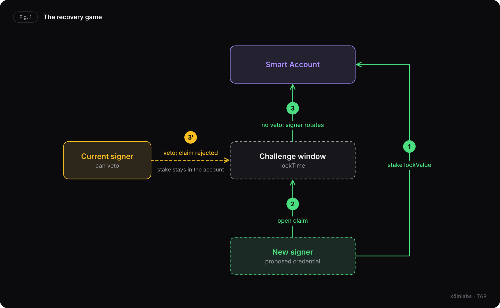
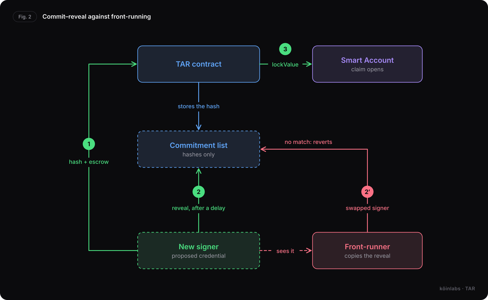
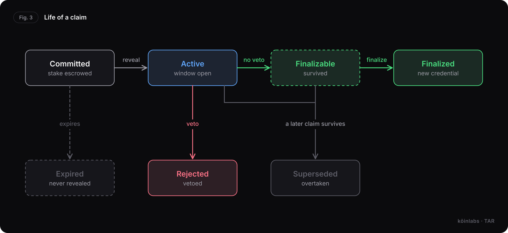
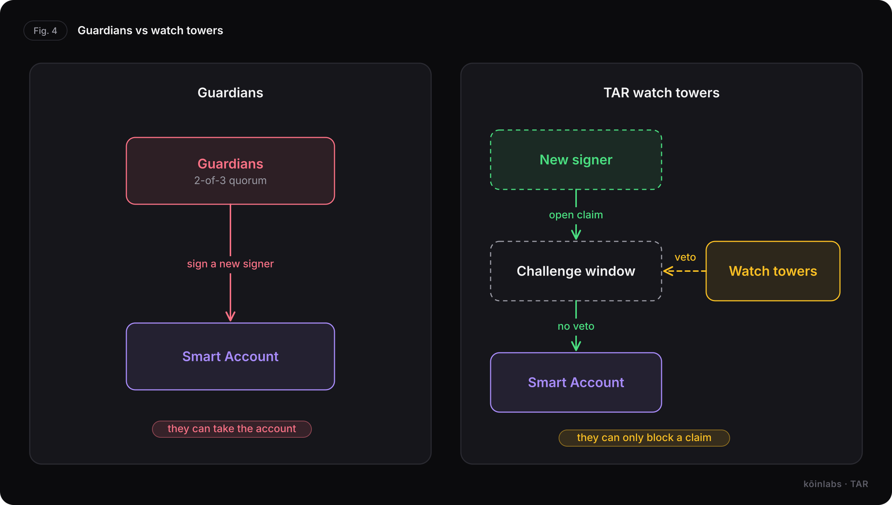
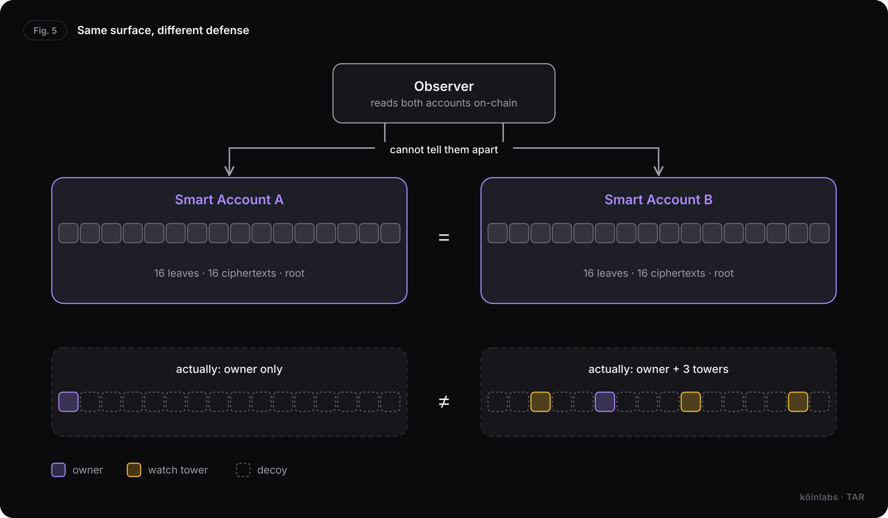
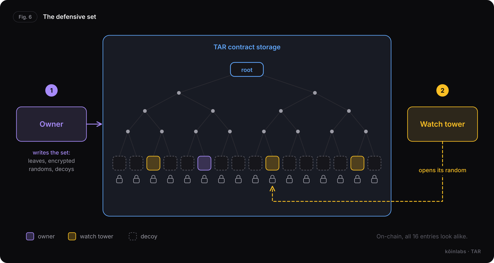
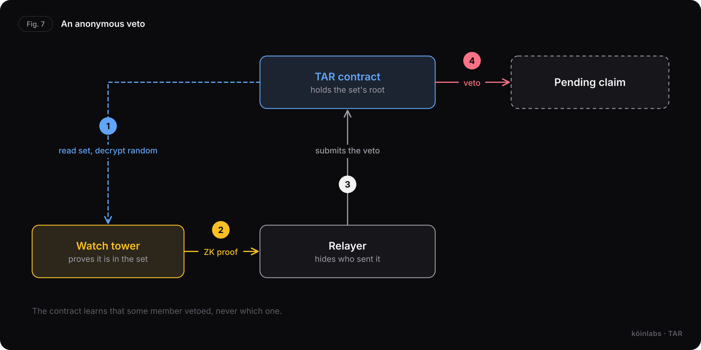
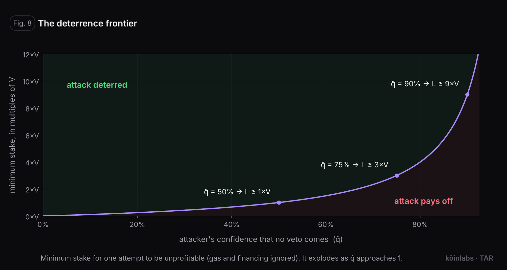
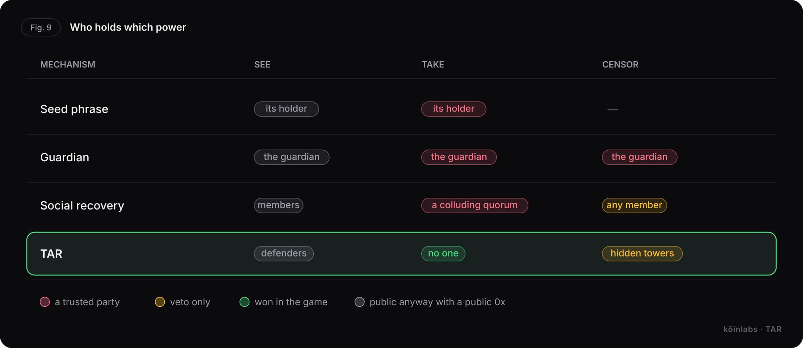

# Timelock Account Recovery

*Koinlabs Research*

---

**TL;DR.** TAR is a trust-minimized recovery mechanism for ERC-4337 / ERC-7579 smart accounts. Instead of trusting guardians to hand an account back, it lets a game decide. Anyone can open a recovery claim, but only by staking collateral (`lockValue`) and surviving a public challenge window (`lockTime`). If the account's defenders veto in time, the claim fails and the stake stays in the account; if not, the new signer takes over. The wait costs a legitimate owner time; it costs an attacker the stake. Defense can be extended to watch towers, which can block a claim but never take the account, and whose presence is hidden: every account exposes the same on-chain structure, and vetoes are anonymous zero-knowledge proofs. Since attackers cannot tell which accounts are watched, even undefended accounts benefit from the doubt. The powers that recovery usually bundles come apart: whoever can block a recovery can never take the account, and taking it needs no one's permission, only surviving the game. First prototyped at ETHGlobal Lisbon 2026 as [Chateau](https://ethglobal.com/showcase/chateau-zybba), TAR has since matured into the v1 design presented here, along with the limits that remain open.

### Introduction

Account recovery remains one of the core unsolved problems of self-custodial wallet design. Externally owned accounts handle it in the most rigid way possible: the user must preserve a seed phrase, and any failure in that process results in either irreversible loss or total compromise. Smart accounts, particularly under ERC-4337, make alternative recovery flows possible. But most existing approaches achieve this by reintroducing trust through another channel: guardians, social recovery committees, and related constructions improve usability by giving some degree of power to third parties.

If smart accounts are to compete with EOAs not only on user experience but also on sovereignty, they need a recovery mechanism that does not depend on actors who can positively take control of the account. The ideal would be a mechanism that is trustless, free, and instant. No such construction is known; Timelock Account Recovery accepts cost and delay as the price of removing trusted third parties from the recovery path. Its premise is that a well-designed game can make dishonest recovery attempts asymmetrically costly: an attacker must put capital at risk and survive a challenge window where the legitimate owner, or hidden defenders acting on their behalf, can stop them. Trust is replaced by deterrence.

A useful consequence is that the game asks nothing of the past. A recovery path that depends on an old key, an encrypted backup or a remembered value has only moved the secret. TAR requires none of them: a locked-out owner enters with a freshly generated credential, on the same terms as anyone else.

### The Core Mechanism

The mechanism rests on two account-level parameters. `lockValue` is the amount of ETH that must be staked to open a recovery claim. `lockTime` is the period that must elapse before the claim can be finalized. A requester opens a claim against a target account, naming the replacement credential they want installed, and the `lockValue` is routed into the targeted account. During `lockTime`, the account's defenders, in the simplest case the legitimate owner, can reject the claim: it is terminated and the stake stays in the account. If the timelock expires without a valid rejection, the requester can finalize the claim: the committed credential is installed, and the requester now controls the account, including the stake they routed into it. Either way, no funds move at the end; the only thing a successful claim changes is who controls the account.



The key property of this mechanism is that unauthorized recovery attempts become costly and exposed to loss. An attacker cannot try for free. They must lock capital, wait through a challenge window, and accept the possibility that the account's defenders will notice the attempt and keep the stake. The system is thus secured not by trust in third parties, but by a game-theoretic asymmetry between the requester and the account they target. Nothing in the game identifies the owner. Recovery stops being a right one exercises and becomes a claim anyone can make; what separates an owner from an attacker is only who the defenders choose to stop.

#### Front-running and the commitment

An immediate vulnerability must be addressed: front-running. If the legitimate owner submits a recovery in the public mempool, an attacker should not be able to observe it and hijack the claim. TAR therefore opens a claim in two steps. The requester first registers a commitment over a closed tuple:

```
commitment = keccak256(target, replacementCredential, refundAddress, salt, domain)
```

`replacementCredential` is the exact bytes the account will install as its new signing authority (an ECDSA key, a passkey, a multisig, a module descriptor; TAR never interprets them). `refundAddress` receives any surplus collateral (explained in next section). `salt` keeps the hash unpredictable, and `domain` (chain ID plus TAR contract address) blocks replay across deployments.

The later reveal must match every field. An observer who copies it and swaps in their own credential, refund address or target produces a hash that was never committed, and the reveal reverts without consuming anything.

A commitment becomes revealable only after a maturity delay, calibrated per deployment from observed inclusion and finality delays. An attacker who spots a reveal in flight cannot commit, mature and fire before it lands.



#### Pricing the commitment

Commit–reveal creates a new object: a public, dated commitment. If it costs nothing, it is a free option. An attacker could park commitments against many accounts and wait for a moment of owner weakness to reveal (camping). Making the commitment carry the stake up front fixes that, but a commitment escrowing exactly `lockValue` points at the accounts configured with that value, and tells observers which account is preparing a recovery.

TAR resolves both at the commit step. The commitment escrows at least the applicable `lockValue`, plus a randomized surplus drawn fresh for every commitment (the overcommit). An observer can bound `lockValue` within a range but never pin it to a point, so the amount stops identifying the target. At reveal, exactly `lockValue` goes to the target and the overcommit is refunded to `refundAddress`.

The escrow carries a single deadline, `commitExpiry`, fixed at registration. A commitment that expires without a valid reveal has its entire escrow permanently retained by the recovery contract. A parked commitment is therefore a decaying asset: its carrying cost is certain, its payoff speculative, and its value goes to zero at expiry. Camping is not made impossible, but it is priced.

A future iteration explores split commitments: a chain of small value-bearing notes, created at spaced intervals and spent together in a multi-input reveal. Spreading the signal over time would keep the target unreadable until it is too late to race, and make camping much harder to sustain (see Conclusion).

#### Concurrent claims

Since anyone can open a claim, several can be active on the same account at once: the owner's recovery, an attacker's, a retry by either. TAR does not serialize them behind a lock, since any lock is something an attacker could hold. Three rules keep a single-signer account coherent instead.

**Cooldown.** The account sets a cooldown `C`, with `0 ≤ C ≤ lockTime`. A claim cannot open within `C` of the previous one, which bounds how fast an attacker can occupy the account.

**Supersession by passage.** The right to rotate is won by surviving, not by finalizing. When a claim's deadline passes with no veto, every earlier claim still pending on the account is superseded and can no longer finalize.

**Sequential rotation.** Finalizing a claim does not cancel later ones. A claim still in its window keeps running and, if it survives too, finalizes on top. The account's credential is always the most recent surviving outcome, and a survivor nobody finalizes stays finalizable indefinitely.

A griefer can therefore delay a legitimate recovery by opening a vetoable claim every `C`, but every cycle costs a full `lockValue` that never comes back. Delay is purchasable, never permanent.

Several stakes in flight must each stay attached to their claim until it settles. At reveal, `lockValue` actually lands in the account's claim pot, one entry per claim, rather than in its balance. An entry can be pulled into the balance only by the account itself, and only once its claim is terminal (rejected, finalized or superseded), so whoever controls the account at a given moment cannot drain stakes still under contest. Entries keep the deadline of the escrow they came from: an entry still unpulled at `commitExpiry` is retained by the contract, unless its claim survived its window, in which case it waits indefinitely, like the claim itself. For a locked-out owner, this means a stake forfeited by a vetoed attacker is collected only if the owner's own recovery completes before that deadline; otherwise the contract retains it.



### Watch Towers: Defense Without Positive Power

Taken alone, the timelock-plus-collateral model already provides a trust-minimized recovery path with meaningful abuse resistance. But its strength depends heavily on attacker uncertainty. If an attacker has reason to believe the owner is inactive, offline, hospitalized, or otherwise unlikely to react within the challenge window, the expected cost of attempting recovery drops significantly. This is the main weakness of a pure timelock design. In theory, unauthorized recovery is risky. In practice, informed attackers can reduce that risk by exploiting contextual information about the owner.

This is where watch towers become useful. A watch tower is an entity that can veto an ongoing recovery during the challenge period, but has no positive control over the account. It can be a friend, an institution, an automated monitor or a self-hosted service, and how it decides that a claim looks unauthorized is its own business. Through TAR it cannot recover the account, move funds, sign as the owner, or rewrite the defensive set. Its only role is to block a suspicious recovery before it finalizes.



This distinction matters. In a traditional social recovery system, recovery actors are part of the account's authority structure. Here, watch towers are not recovery authorities. They are defensive actors with strictly negative power. This keeps the trust surface far narrower: they can prevent a bad transition, but they cannot produce a privileged one. It also changes how defense scales. Each additional watch tower adds an independent way to stop an attacker without adding a party the legitimate owner must coordinate with to recover; an unavailable tower reduces coverage but never blocks recovery.

In v1, the owner's own veto runs through the same defensive set: the owner holds a position like any tower, and an owner veto is indistinguishable from a tower veto. The owner's other powers, ordinary control of the account and the right to rewrite the set, stay outside the veto path. The set is live: vetoes are checked against the account's current set at veto time, and the account can replace it at any moment, including while claims are active. A misbehaving tower can be removed mid-claim; a new one can veto claims opened before it joined. One valid veto is enough to reject a claim. Threshold *m-of-n* vetoes are a separate construction, outside v1.

The direct utility of watch towers is obvious when the owner is temporarily unavailable. But their deeper value is strategic. If an attacker can determine exactly which accounts are protected by additional defensive actors and which are not, they can simply avoid the defended ones and target the rest. A visible defense strengthens the accounts that have it, but it does not meaningfully protect those that do not. What matters far more is making it difficult to tell which accounts are weak targets in the first place.

### Indistinguishability and Anonymous Vetoes

The watch tower mechanism becomes significantly stronger once the defensive set is not exposed publicly. Ideally, an attacker inspecting an account should not be able to determine whether additional defensive actors exist, how many there are, or who they are.

The privacy goal is therefore not merely to hide the identities of individual watch towers. It is to preserve indistinguishability between accounts with different defensive configurations. An account protected only by its owner should look externally identical to an account backed by one or several hidden veto actors, and a veto should not reveal who cast it, not even whether it came from the owner or a tower. This creates a system-level effect: once defended and undefended accounts become externally indistinguishable, even accounts with no additional defensive actors benefit from the uncertainty created by those that do have hidden watch towers.



#### A constant-shape defensive set

Indistinguishability starts with how the defense is stored. Every TAR account commits to its defensive set as a Merkle tree of the same fixed size: sixteen leaves, all of them always occupied, whether the account has zero, one or fifteen watch towers. Leaves not held by a real member are filled with decoys that look exactly like real ones. The contract stores the leaves, the root it recomputes from them, and one ciphertext per leaf (below). From the outside, every account's defense has the same shape: sixty-five storage words (sixteen leaves, the root and sixteen 96-byte ciphertexts), whatever the number of towers.

Each member holds a veto secret and hands the owner only its hash, an identity commitment. A leaf is the hash of that commitment together with a fresh random value, so the same tower produces a different leaf in every account and every version of the set, and cannot be recognized across them. To prove membership later, a member needs that random. Rather than publishing it, the owner encrypts it to the member's key and stores the ciphertext next to the leaf: a simple key exchange that never puts a member list, an identity or a public key on-chain. A tower finds its own leaf by trying to decrypt the sixteen ciphertexts; only its own opens.

Every update rewrites the whole tree with fresh randoms and fresh encryptions. Adding a tower, removing one or changing nothing all produce updates that look identical, so an observer can neither follow a position from one version of the set to the next nor tell what changed.



#### The anonymous veto

A watch tower does not identify itself when vetoing. It produces a zero-knowledge proof, from a small custom Noir circuit, showing that it knows the secret and the random behind one of the sixteen leaves, and that this leaf belongs to the account's current tree. The proof reveals nothing else: not which leaf, not whether the prover is the owner or a tower, not how many real members the set holds. The contract checks it against the root it stores for the account and against the specific claim being vetoed, so a proof made for one claim cannot be reused on another.

Because each proof is tied to a single claim and a vetoed claim is final, TAR needs no nullifier, and nothing in the transcript links two vetoes by the same member. Anyone can submit a valid proof with the same effect, and a failed veto gives no hint as to why it failed. The proof hides the leaf, not the transaction, though: a tower that submits from its own address identifies itself. Veto anonymity therefore assumes a relayer that is reachable when a veto must land and does not link submissions to the towers behind them.



#### Uncertainty as a security resource

An interesting second-order effect may emerge naturally from the system's incentive structure. If failed recovery attempts transfer meaningful value to the targeted account, then some actors may find it rational to hunt attackers by polluting the off-chain signals an attacker relies on to identify vulnerable targets: social media accounts that appear abandoned, forum posts lamenting lost devices, staged inactivity patterns. The attacker is left with a single, uncomfortable fact: the only reliable way to test whether an account is truly vulnerable is to play the TAR game against it. The system does not need a large organized class of hunters; it only needs attackers to believe that some fraction of the signals they collect are deliberate traps.

The security of the mechanism should therefore not be understood as resting on a single line of defense. The base layer comes from economic collateral and delayed finality: a malicious requester must lock capital and wait. The second layer comes from the legitimate owner's ability to reject the recovery during the challenge period. The third layer comes from hidden watch towers that may exist even when the owner is unavailable. Finally, the system may acquire a background layer of deterrence if the economic incentives lead some actors to operate believable trap accounts. Together, these layers damage the attacker's confidence in their own target classification model: uncertainty about owner liveness, hidden veto policies, and deceptive targets. That uncertainty is itself a security resource.

### The Deterrence Model

Collateral and delay do not authenticate anyone, and they do not make unauthorized recovery impossible. They turn it into a bet. TAR's security therefore rests on three different kinds of claim: mechanical guarantees enforced by the contract (no finalization before the deadline, no substitution of the committed credential), a liveness assumption (at least one defender able and willing to act in time), and economic deterrence, which depends on uncertainty and on how the parameters are calibrated.

An attacker weighs what they could extract from the account, $V$, against the stake they put at risk, $L$, using their own estimate $\hat{q}$ of the chance that no veto comes. Ignoring gas and financing costs, a single attempt is worth:

$$EV = \hat{q}\,V - (1 - \hat{q})\,L$$

The stake does not count against a successful attacker, who takes the account that holds it. The attack is deterred when this value is negative, which requires a stake that grows with the attacker's confidence and becomes unreachable as $\hat{q}$ approaches 1: an attacker sure that nobody is watching treats the stake as a price, not a risk.

This is where the pieces come together. The formula involves two different quantities. The account's actual exposure is $q$, the probability that no veto lands in time, set by its real defense: the owner's liveness and the towers it actually has. The attacker never sees $q$; they act on $\hat{q}$, an estimate built from whatever they can observe. Safety is governed by $q$, deterrence by $\hat{q}$.

Where defense is legible, the two coincide. An attacker reads the guardian list or identifies the sole canceller, sets $\hat{q} \approx q$, and each account is deterred, or not, by its own defense alone: the weakest are picked off first. TAR is built to break that correlation. The constant-shape set hides how many towers exist, anonymous vetoes hide who has ever acted, and the overcommit hides which `lockValue` a commitment is aimed at. What stays observable on-chain carries no information about the defense, so the best estimate an attacker can form for account $i$ is $\bar{q}$, the average of $q$ across the accounts it cannot be told apart from:

$$\hat{q}_i = \mathbb{E}[\, q \mid \text{observables}_i \,] \approx \bar{q}$$

Two consequences follow. First, deterrence becomes a property of the population rather than of the account. An undefended account, whose true $q$ is close to 1, is priced by attackers at $\bar{q}$, and borrows the protection of the defended accounts it looks identical to. Second, the only way to sharpen $\hat{q}$ for a given account is to play the game against it, and every failed sample costs $L$. Off-chain signals (visible inactivity, a post about a lost device) remain the attacker's last lever for pulling $\hat{q}$ back toward $q$, and that lever is exactly what trap accounts contaminate.

The decorrelation is only as strong as the residual leaks allow. Update timing, gas payers and operational mistakes (see Limitations) are channels through which $\hat{q}$ can drift back toward $q$, as are correlations with what stays public: if large balances are systematically better defended, attackers will price that in.

Adding watch towers helps in the obvious way: each independent tower is one more chance that someone notices and vetoes. Independence is the catch, since towers sharing an operator, an infrastructure or a jurisdiction tend to fail together. Defenders can also be bribed into silence, but unlike a guardian quorum, that coalition must put the stake at risk and rely on every tower staying quiet for the whole window; a single defection stops the attack, and the stake stays in the account.

The protocol pays nothing for a veto: a fee per veto would make censorship profitable and expose who vetoed. Towers are funded outside the protocol, bundled into a wallet's service, paid by subscription, or covered by relay revenue. Nor are there universal values for `lockValue` and `lockTime`: they depend on what the account holds and on how fast its defenders actually respond.



### The Three Powers of Recovery

To understand what TAR changes, and what it does not, it is useful to name the powers that every recovery mechanism grants. There are three.

The power to *see*: read the account's address, balances, and transaction history. The power to *take*: finalize a recovery and obtain custody. And the power to *censor*: veto a recovery, or refuse to help.

Historically, these three powers have been treated as one. A seed phrase fuses *see* and *take* into a single secret: whoever derives the public key sees the balances; whoever holds the private key spends them. A guardian holds all three. Social recovery distributes them across a committee, but colluding members recover every power intact. The transparency of public blockchains made the power to *see* feel like a default rather than a grant, which is why it was never named.

When the account address is public, granting *see* to a recovery actor adds nothing they could not learn on their own. The power that matters is *take*, and in the standard case where a public 0x holds the funds, TAR removes it from trusted hands entirely. No trusted actor can approve or finalize a recovery on anyone's behalf; *take* is won only by a claim that survives the common game. *Censor* belongs to the defensive set, bounded to vetoing one claim at a time and invisible in its composition. A residual trust remains in the watch towers, who must veto when they should, but they cannot *take*, and their failure to act leaves the owner's own veto intact.



### TAR in a Private Setting

Everything described so far assumes the dominant case: a public account address that resolves directly to the funds. The situation changes when the address is deliberately hidden. A wallet that uses an ENS name as its public identity, stealth addresses for receiving, and privacy-preserving transfers has dissociated its public handle from its on-chain footprint. The 0x is not invisible, but it is not publicly linked to the user. Losing one's keys then means losing not just the ability to spend, but the knowledge of which account to recover. The 0x must be found before the game can begin, and finding it requires help.

This is where the three powers become structurally separate. The entities that help the user reconstruct their address (friends, guardians, a recovery service) gain the power to *see*. In every existing recovery model, those same entities also hold the power to *take*, or could collude to exercise it, so a user who hides their address must choose between recoverability and confidentiality.

TAR breaks this dilemma. Helpers guide the user back to their address, possibly through a threshold scheme so that no single helper sees it alone, and the economic game handles the transfer of control. A helper who abuses that knowledge to attempt a takeover must stake capital, survive a public timelock, and face vetoes from defenders whose existence they cannot confirm. Colluding helpers gain vision; beyond that, they gain only the right to stake, wait, and lose.

This setting is outside TAR v1. In v1, the account address is plain data: knowing it grants no authority, and it is usually recoverable from past transfers or a name record. Private-account recovery is a separate project that would use TAR as its take layer, and it still has its own open problem: helpers who participated in resolution can link the user's handle to their address if they collude.

### Related Work and Positioning

TAR does not invent delayed recovery, and it is worth being precise about what is borrowed and what is new.

| Family | What authorizes recovery | Examples | What remains trusted |
| --- | --- | --- | --- |
| Secret duplication | Reassembling stored material | [Ledger Recover](https://www.ledger.com/ledger-recover/), Shamir backups | Fragment holders, identity check |
| Positive third parties | A quorum approves the new credential | [Social recovery](https://vitalik.eth.limo/general/2021/01/11/recovery.html), [Argent](https://support.argent.xyz/hc/en-us/articles/360022631412-About-wallet-recovery), [ZK Email recovery](https://zk.email/case-studies/recovery), [ERC-7579 modules](https://erc7579.com/tooling/module-sdk/using-modules/social-recovery) | The guardian quorum |
| Delay with cancellation | An approved action can be stopped in a window | [Zodiac Delay Modifier](https://github.com/gnosisguild/zodiac-modifier-delay) | The canceller's live credential |
| Bonded optimistic claims | A claim stands unless a bonded challenge lands | [Optimistic rollups](https://ethereum.org/developers/docs/scaling/optimistic-rollups/), [Kleros](https://docs.kleros.io/) | One honest challenger, the adjudication |
| Reactive key-loss claims | Open entry, contested in the open | [KELP](https://eprint.iacr.org/2021/289) (2021) | The surviving old key |

Delayed, challengeable recovery already ships in production: Argent's guardian recovery uses an owner-cancellable timelock, Safe accounts can gate module actions behind the Zodiac Delay Modifier, and several ERC-7579 recovery modules combine guardians with a waiting period. Their shared limitation, relative to sovereignty, is that the actor who triggers recovery holds positive power: a guardian can, alone or by collusion, produce a privileged state transition. The defense is also legible per account: guardians are named, or the owner is known to be the sole canceller.

The closest precursor is KELP (Reactive Key-Loss Protection, FC 2021), which already admits open recovery claims through commit–reveal and lets them be challenged. TAR's skeleton was designed independently at ETHGlobal Lisbon 2026, where it was first built as [Chateau](https://ethglobal.com/showcase/chateau-zybba), and KELP was found afterwards; priority for the shared skeleton belongs to KELP. TAR re-cuts three things. KELP's challenge proves possession of the old key, whereas TAR's veto asks for no pre-loss credential, only membership in a hidden defensive set. Both route the claimer's fees or stake into the targeted account, but KELP's challenger is always the old key holder and collects the losing claim's fees, whereas a TAR veto may come from a third party and is deliberately uncompensated, so that blocking a claim never becomes a paid service and never reveals who cast it. KELP asks its owner to manufacture camouflage with cover traffic, whereas TAR's hiding is structural: fake claims obscure whether a reveal signals a real key loss, a constant-shape set obscures whether a defender exists.

The other ingredients are assembled, with credit to their sources: the claim, challenge window and capital at risk from optimistic rollups and bonded dispute systems; anonymous group membership from [Semaphore](https://semaphore.pse.dev/learn); cancellable delay from Argent and Zodiac. The contribution is their combination: recovery that (1) anyone can initiate, gated only by a stake rather than by authorization; (2) is defended by actors with strictly negative power, who can block but never take; and (3) whose defensive composition is indistinguishable on-chain, turning uncertainty about who is watching into a population-level security property.

### Limitations

A security mechanism is judged by what it admits.

TAR depends on liveness. The owner, or at least one watch tower, must observe the claim, classify it, produce a proof and get a veto included within `lockTime`. A permanently incapacitated owner with no watch towers is technically defenseless. Indistinguishability limits the risk (an attacker cannot know the account is undefended), but it does not change the underlying fact: if no one is watching, the recovery will succeed. This is the structural trade-off against social recovery models, where guardians must actively approve rather than passively watch.

Recovery requires capital. The user must stake `lockValue` to open a claim. A user who has genuinely lost everything may be unable to produce this capital. Third-party fronting against a fee is possible in principle, but it is a market that must emerge rather than a guarantee.

Recovery is not instant. `lockTime` must be chosen: too short, and the challenge window is insufficient for defenders to react; too long, and legitimate recovery becomes burdensome. There is no universally correct value, and if an attacker becomes confident that no veto will come, `lockValue` becomes a price rather than a deterrent.

Some attacks are priced, not prevented. A well-capitalized attacker can keep renewing commitments against an account, or keep buying delay against a legitimate recovery at one `lockValue` per cooldown. TAR makes no complete claim against commitment spam and defender exhaustion.

TAR addresses key loss, not key theft. An attacker holding a currently valid key does not need recovery: they can use the account directly, and can replace its defensive set. TAR restores access to a locked-out owner; it does not evict an active intruder.

A malicious watch tower is a griefing vector. A watch tower's power is strictly negative, but negative power still includes vetoing the legitimate owner's recovery, indefinitely. Because owner and tower vetoes must look identical on-chain, a rogue tower can reject every attempt by the owner, each one costing a full stake, while the owner, who has lost their keys, cannot update the set to remove it. This is the design's sharpest open edge.

Privacy has residuals. The timing and frequency of set updates are public. The owner knows its whole set, decoys included. Gas payers, timing, transport metadata and operational mistakes can support inference, and veto anonymity rests on the broadcaster assumption. A custom circuit and verifier also add audit surface: soundness, zero knowledge and integration require independent review.

### Conclusion

Timelock Account Recovery replaces trust with deterrence. In the standard case, where a public account address holds the funds, no guardian, no committee, no third party can take what the game alone controls. A residual trust remains in the watch towers, who must actually veto when they should; but they cannot take, and an owner who still holds a credential can always supplement or replace them. Beyond v1, where the address itself must be recovered, the same separation lets trusted helpers guide the user home without being able to seize the house.

The v1 scope is a normative protocol (lifecycle, defenses, economics, invariants, threat model and adversarial scenarios) and its implementation: an ERC-7579 module demonstrated on Kernel and Safe, the Noir veto circuit with a relay-compatible submission path, an npm SDK, invariant and conformance tests, and an audit-ready release candidate followed by an independent audit once funded. Threshold vetoes, private-account recovery and a project-operated tower network are out of scope.

The main direction beyond v1 is a multi-input reveal: instead of one escrowed commitment, a claim would spend a chain of small value-bearing notes, created at spaced intervals and each expiring on its own. Spreading the signal over time keeps the target unreadable until it is too late to race, and pricing catch-up in elapsed time makes camping far harder to sustain. It is accepted as a direction, not yet as protocol.

Feedback is most useful on the open edges, defender censorship of a locked-out owner first among them.
